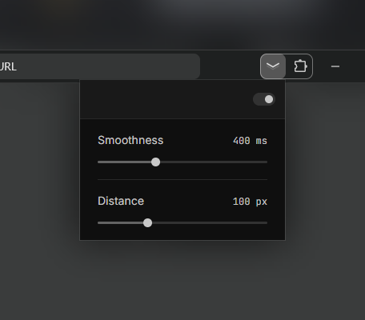

**Inertia** brings smooth, natural scrolling to Chromium-based browsers. Turn the wheel or press an arrow key, and the page eases into motion, then gently settles into place. Scroll faster to move through a long page, or take it one step at a time as you read.

## *Preview*

## *Install*

1. Extract the archive to a folder you want to keep.
2. Open `chrome://extensions` and turn on **Developer mode**.
3. Click **Load unpacked** and select the folder containing `manifest.json`.
4. Reload any ordinary web pages that were open before installation.

## *Settings*

| Control | Default | Effect |
| --- | --- | --- |
| Enabled | `On` | Turns Inertia on or off across all sites. |
| Smoothness | `400 ms` | Duration of one wheel or keyboard step, from 100 to 1000 ms. |
| Distance | `100 px` | Distance per wheel notch, from 20 to 300 pixels. |

## *Credits*

The animation uses Michael Herf's [Pulse](https://stereopsis.com/stopping/).
